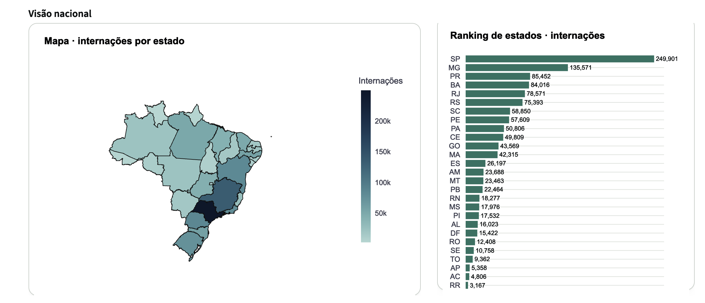
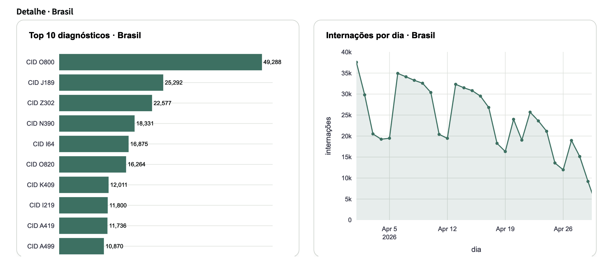
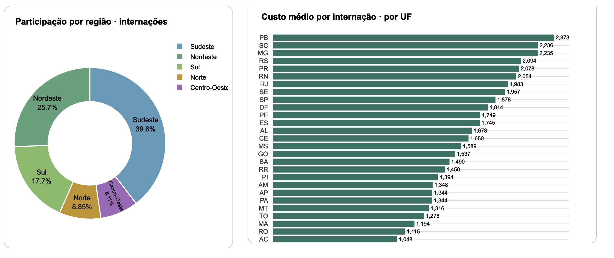

# Internações do SUS · pipeline e dashboard por estado

[](https://github.com/Nayanearaujo/pipeline-saude-sus/actions/workflows/ci.yml)


Pipeline de dados de ponta a ponta sobre as **internações hospitalares do SUS**
(SIH/SUS, DATASUS), em **Python + DuckDB**, com um **dashboard interativo por
estado** em Streamlit. Parte dos microdados oficiais e chega a um painel que
compara os 27 estados em volume, gasto, permanência e mortalidade.

> Recorte: internações de **abril de 2026**, Brasil inteiro, com o **Rio de
> Janeiro** como foco da análise. Dados públicos do Ministério da Saúde.

## Links

- 📊 **Dashboard ao vivo (Streamlit):** https://pipeline-saude-sus.streamlit.app/
- 📖 **Guia do projeto (GitHub Pages):** https://nayanearaujo.github.io/pipeline-saude-sus/
- 📄 **Relatório executivo (estático):** https://nayanearaujo.github.io/pipeline-saude-sus/relatorio.html
- 💻 **Repositório:** https://github.com/Nayanearaujo/pipeline-saude-sus

## Demonstração

Painel interativo com seletor de estado, construído com Streamlit e Plotly.

👉 **Acesse o dashboard ao vivo:** https://pipeline-saude-sus.streamlit.app/

**Visão nacional: mapa e ranking de estados**


**Detalhe: top 10 diagnósticos e internações por dia**


**Participação por região e custo médio por estado**


---

## Achados

O que o dado mostrou, e o que só apareceu porque cada número foi conferido
contra a fonte em vez de aceito como saiu da consulta:

1. **Metade das internações "de abril" entrou em outro mês.** O arquivo RD é por
   competência (mês de pagamento da AIH). Dos 1.238.763 registros processados
   (camada bronze), só 703.067 têm data de *entrada* em abril/2026; 343.386
   entraram em março, 100.989 em fevereiro. Por isso a série diária (por data de
   entrada) não soma o KPI de internações (por competência): são duas perguntas
   diferentes, e o painel diz qual é qual.
2. **Um em cada vinte bebês estava na faixa etária errada.** A idade no SIH vem
   com `COD_IDADE` (a unidade: dias, meses, anos). Ignorar isso jogava 60.840
   internações medidas em dias/meses para faixas de adulto. Corrigido, a faixa
   "< 1 ano" saltou de **1,4% para 4,9%** da base, coerente com o peso da
   neonatologia no SUS.
3. **Os nomes das doenças sumiam em silêncio.** O gerador de dicionários, sem
   internet, cai num modo neutro e grava "CID O800" no lugar do nome. O `LEFT
   JOIN` funcionava, mas juntava com rótulo vazio. Rodando com internet, os
   12.451 nomes reais do DATASUS entram, e o Top 10 mostra "Parto espontâneo
   cefálico", não o código cru.
4. **O grão foi protegido contra colapso silencioso.** Um `SELECT DISTINCT` da
   linha inteira juntaria duas AIH distintas de campos iguais numa só. Trocado
   por dedup explícita por AIH e travado por regra de qualidade:
   `count(*) = count(DISTINCT aih)` (1.238.234 = 1.238.234).

---

## As quatro etapas do pipeline

Este projeto refaz, do zero e com um dataset novo (SUS), o caminho das quatro
aulas do curso: da ingestão ao dashboard.

| Etapa | O que faz | Arquivo |
|---|---|---|
| **1 · Ingestão** | lê os `.dbc` do SIH para a camada bronze, tudo texto | `pipeline/ingestao.py` |
| **2 · Transformação** | tipa e decodifica os códigos do SIH (camada prata) | `pipeline/transformacao.py` |
| **3 · SQL / Marts** | 10 indicadores em **SQL puro** (camada ouro), com CTE, window function, `RANK` e `HAVING` | `pipeline/marts.py` + `sql/marts/*.sql` |
| **4 · Dashboard + testes + qualidade** | painel interativo, testes com cobertura acima de 90% e checagens que travam o build | `app.py`, `painel.py`, `pipeline/qualidade.py`, `test/` |

---

## Arquitetura: três camadas

```
data/raw/ (.parquet + .csv)  ──ingestao.py──▶  bronze.*   espelho do arquivo, tudo texto
                                                 │
                                          transformacao.py
                                                 ▼
                                              prata.*     tipado, códigos do SIH decodificados
                                                 │
                                          marts.py + sql/marts/*.sql
                                                 ▼
                                              ouro.*      indicadores por estado
                                                 │
                                          painel.py ──▶ app.py (Streamlit)
```

| Camada | O que é | Quem constrói |
|---|---|---|
| **bronze** | os 3 arquivos como vieram, todas as colunas texto | `pipeline/ingestao.py` |
| **prata** | tipado (valor→`DECIMAL`, data→`DATE`), códigos do SIH decodificados (sexo, UF, óbito), nomes legíveis. 1 linha = 1 internação | `pipeline/transformacao.py` |
| **ouro** | uma tabela por pergunta: KPIs, por estado, diagnósticos, perfil, série diária | `pipeline/marts.py` + `sql/marts/*.sql` |
| **dashboard** | a tela. Nunca calcula: todo número sai de um mart | `painel.py`, `app.py` |

---

## Como baixar os dados

Os microdados do SIH vêm em `.dbc` (formato legado do DATASUS). Dois scripts
geram tudo em `data/raw/` (precisam de internet; a pasta não vai para o Git):

```bash
uv sync
uv run python baixar_dados.py        # baixa os .dbc do DATASUS direto (HTTPS,
                                      # converte com pyreaddbc) -> internacoes.parquet
uv run python gerar_dicionarios.py   # baixa IBGE + CID-10 -> cid10.csv, municipios.csv
```

- **`internacoes.parquet`** — microdados do SIH-RD, uma linha por AIH.
  `baixar_dados.py` baixa os `.dbc` por UF e converte com `pyreaddbc` + `dbfread`
  (não usa o PySUS).
- **`cid10.csv`** — `codigo,descricao` (CID-10 → nome da doença). Fonte: DATASUS.
- **`municipios.csv`** — `codigo,municipio,uf` (código IBGE → município, UF).
  Fonte: IBGE.

> `gerar_dicionarios.py` baixa as tabelas oficiais. Sem internet ele cai num
> **modo neutro** (nome = `CID <codigo>` / `Municipio <codigo>`), que mantém o
> pipeline rodando mas deixa os rótulos sem o nome real. Rode-o com internet
> antes de publicar, ou os gráficos mostram o código cru no lugar da doença.

> Se abril/2026 ainda não estiver publicado (o SIH tem 2 a 4 meses de atraso),
> ajuste `ANO`/`MES` no topo de `baixar_dados.py` para o último mês fechado.

---

## Como rodar

```bash
# baixar os dados (gera data/raw/, não vai para o Git)
uv run python baixar_dados.py             # baixa o SIH-RD de abril/2026 (27 UFs)
uv run python gerar_dicionarios.py        # gera cid10.csv e municipios.csv

# pipeline, do arquivo ao indicador
uv run python -m pipeline.ingestao        # data/raw -> bronze
uv run python -m pipeline.transformacao   # bronze   -> prata
uv run python -m pipeline.marts           # prata    -> ouro
uv run python -m pipeline.qualidade       # checagens de qualidade (falha se nao fechar)

# (alternativa) tudo numa tacada: bronze -> prata -> ouro -> qualidade
uv run python executar.py

# dashboard interativo
uv run streamlit run app.py               # abre em localhost:8501

# relatório estático em HTML (gera relatorio.html e docs/relatorio.html)
uv run python relatorio.py

# testes e lint
uv run pytest --cov                        # unitários, dado inventado, cobertura >= 70%
uv run ruff check .                        # estilo e imports
```

### Resultado de uma execução (abril/2026, Brasil)

Números reais de uma execução completa do pipeline, para conferência:

```
ingestao      bronze.internacoes  1.238.763 · cid10 12.451 · municipios 5.571
transformacao prata.internacoes   1.238.234 linhas (-529 sem valor)
marts         10 marts, 16.400 linhas na camada ouro
```

A camada bronze tem 1.238.763 AIH processadas em abril/2026; a prata mantém
1.238.234 (529 saem por não ter valor). O mart `por_estado` conta só as com UF
e valor válidos: **SP** lidera com 249.866, seguido de **MG** (135.542), **PR**
(85.435), **BA** (83.953) e **RJ** (78.503).
*(Os dados brutos não ficam no repositório; rode `baixar_dados.py` para gerá-los.)*

---

## O que uma linha representa (grão)

| Tabela prata | Uma linha é… |
|---|---|
| `internacoes` | uma internação (AIH): município, UF, diagnóstico, procedimento, valor, dias, idade, sexo, óbito, datas |
| `cid10` | um código CID-10 e o nome da doença |
| `municipios` | um município do IBGE |
| `ufs` | uma unidade federativa (código, sigla, região) |

A camada prata decodifica os códigos crípticos do SIH: `SEXO` 1/3 → Masculino/
Feminino, `MORTE` → booleano, `DT_INTER` (AAAAMMDD) → data, `VAL_TOT` →
`DECIMAL`, e deriva a UF/região a partir do código IBGE do município.

---

## Indicadores (camada ouro)

Cada mart tem o grão declarado na primeira linha do `.sql`.

| Mart | Pergunta | SQL em destaque |
|---|---|---|
| `kpis_gerais` | os números de topo do painel (Brasil) | agregações + `FILTER` |
| `por_estado` | volume, gasto, custo médio/mediano, permanência e mortalidade por UF | `MEDIAN`, `SUM() OVER ()` |
| `top_diagnosticos` / `_brasil` | as 10 doenças que mais internam, por UF e nacional | `ROW_NUMBER() OVER (PARTITION BY uf)` |
| `perfil_demografico` / `_brasil` | internações por faixa etária e sexo | `CASE WHEN` |
| `internacoes_diarias` / `_brasil` | série diária ao longo do mês | `GROUP BY` data |
| `mortalidade_por_cid` | doenças de maior letalidade (100+ internações) | CTE + `HAVING` + `RANK()` |
| `municipios_pareto` | quantos municípios concentram 80% do gasto | soma acumulada `SUM() OVER (ORDER BY)` |

---

## O dashboard

Antes de escrever o código da tela, o painel foi estruturado respondendo às
**três perguntas de negócio da Aula 4**:

1. **Para quem é?** Gestores públicos de saúde, analistas e auditores do SUS que
   precisam comparar rapidamente o desempenho hospitalar dos estados.
2. **O que precisa saber primeiro (teste dos 5 segundos)?** Se o volume, o gasto
   e os desfechos estão dentro do esperado — respondido imediatamente pelos
   **5 cartões executivos no topo** (com subtítulo explicativo da métrica).
3. **O que a pessoa pergunta depois do primeiro olhar?** *"Onde está concentrado?"*
   (visão nacional: mapa coroplético, ranking de UFs, participação por região e
   desigualdade de custo médio) e *"Em quais doenças, quando e em qual público?"*
   (detalhe recortado por UF: top 10 diagnósticos, série diária de entradas e
   perfil demográfico por idade e sexo).

Abre com a **visão Brasil** e tem um **seletor de estado** que recorta tudo:

- **5 cartões:** internações, gasto total (compacto e valor integral), custo
  médio, permanência média e mortalidade. No "Brasil" vêm do `kpis_gerais`; numa
  UF, da linha do `por_estado`.
- **Mapa do Brasil** (coroplético por UF) e **ranking de estados**, com métrica
  escolhível e subtítulo-resposta automático (*"SP lidera: 249.866 (20,2% do total)"*).
- **Custo médio por UF** (desigualdade regional entre estados).
- **Top 10 diagnósticos**, **série diária** e **perfil por idade/sexo**,
  recortados pelo estado selecionado.
- **Zero cálculo na tela:** `painel.py` e `app.py` não usam `groupby`, `sum`,
  `mean` nem `merge`; toda participação percentual e posição de ranking já vem
  calculada dos marts via *window functions*.

> **Para abrir no Power BI ou Tableau:** os CSVs da camada ouro ficam prontos em
> `dados_painel/`. Ao importar no Power BI em português, defina a localidade da
> coluna decimal como **Inglês (Estados Unidos)** (para que o ponto decimal não
> seja lido como separador de milhar) e use **Não resumir** nos cartões de taxa
> e custo médio (média de médias não é a média nacional).

---

## Testes automatizados e qualidade de dados

O projeto separa **testes unitários de código** (`test/`, com `pytest` e dados
inventados em `tmp_path`) das **regras de qualidade de dados** (`pipeline/qualidade.py`,
26 asserções SQL que rodam sobre o banco real e travam o pipeline se algum
número não fechar):

| Módulo testado | Escopo dos testes unitários | Cobertura |
|---|---|---|
| `pipeline/db.py` | conexão isolada em `tmp_path`, `criar_schema` idempotente e carga `gravar()` | **100%** |
| `pipeline/ingestao.py` | leitura em texto (`VARCHAR`), idempotência e falha rápida sem criar banco vazio quando falta arquivo | **97%** |
| `pipeline/transformacao.py` | `CAST` estrito (sem `TRY_CAST` silencioso), decodificação de `COD_IDADE`/`SEXO`/`MORTE`, dedup determinística por AIH e dicionários | **97%** |
| `pipeline/marts.py` + `sql/marts/*.sql` | transação com `ROLLBACK` em erro SQL, validação de prefixo, marts 01 a 10 (incluindo fronteiras de `faixa_etaria`, `HAVING >= 100` e Pareto 100%) | **96%** |
| `pipeline/qualidade.py` | aprovação em banco íntegro e bloqueio imediato (`SystemExit`) quando a soma das partes não bate com o KPI | **96%** |
| `painel.py` + `exportar_painel.py` | formatadores BR puros (sem depender de `locale`), figuras Plotly, fallback DuckDB/CSV e exportação da camada ouro | **98%** |
| `relatorio.py` + `gerar_dicionarios.py` | geração determinística do HTML (`div_id` fixo e tamanho em KB), consumo da API oficial do IBGE com mock e fallback para modo neutro sem internet | **96%** |
| **TOTAL (59 testes)** | **Meta do desafio: 70%** · **Alcançado:** | **> 96%** |

---

## Estrutura do projeto

```
pipeline-saude-sus/
├── pipeline/            db.py, ingestao.py, transformacao.py, marts.py, qualidade.py
├── executar.py          roda bronze -> prata -> ouro -> qualidade numa tacada
├── ui.py                abre o DuckDB UI local (http://localhost:4213) sobre o sih.duckdb
├── indicadores.md       10 indicadores, as 3 pilhas da Aula 2 e definicoes de grao
├── design/rascunho.png  wireframe 1440x1024 em grade de 12 colunas (Aula 4)
├── .github/workflows/   ci.yml (pytest + ruff) e keepalive.yml (acorda o Streamlit)
├── sql/marts/           10 marts .sql, grão declarado no topo de cada arquivo
├── painel.py            lê os marts, formata e desenha (zero cálculo na tela)
├── app.py               dashboard Streamlit interativo por estado
├── baixar_dados.py      baixa os .dbc do SIH (DATASUS) para data/raw/
├── gerar_dicionarios.py consulta API oficial do IBGE + DATASUS -> data/raw/
├── dados_painel/        camada ouro exportada em CSV (lida pelo app na nuvem)
├── exportar_painel.py   exporta a camada ouro para dados_painel/
├── relatorio.py         gera o relatório estático (relatorio.html) da camada ouro
├── docs/                GitHub Pages: index.html (guia) e relatorio.html (executivo)
├── test/                59 testes pytest com dado inventado e mocks de rede
├── data/raw/            os arquivos baixados (não versionados)
└── pyproject.toml
```

---

## Decisões de engenharia e controle de grão

As decisões de transformação (o que é descartado, como cada código é
decodificado, por que o valor é `DECIMAL(12,2)` e o código IBGE é texto) estão
documentadas em `indicadores.md`, nos comentários de `transformacao.py` e no
topo de cada `.sql`. Como em SQL um `JOIN` mal especificado não gera erro de
sintaxe — apenas multiplica linhas silenciosamente —, cada mart declara
explicitamente o seu grão e é validado pelas 26 regras de `pipeline/qualidade.py`
contando linhas e somas antes e depois.

## Limitações e notas de dado

Escolhas e limites conhecidos deste recorte, declarados para leitura honesta dos
indicadores:

- **Série diária não soma o total.** Os marts `internacoes_diarias*` filtram a
  **data de internação** dentro de abril/2026. Como o arquivo é por competência
  (mês de processamento), parte das AIH pagas em abril teve entrada em meses
  anteriores: a série soma ~703 mil internações, não as 1,24 M dos cartões. O
  filtro é proposital (datas antigas esticariam o eixo), mas a diferença é
  grande; o gráfico mostra "entradas de abril", não o faturamento do mês.
- **UF é a de residência do paciente** (`MUNIC_RES`), não a do hospital. "Gasto
  por estado" aqui é por onde o paciente mora. O arquivo também traz a UF de
  internação (`UF_ARQUIVO`); trocar a referência muda o resultado.
- **Valor = valor pago pelo SUS** (`VAL_TOT`), não o custo real do hospital. O
  rótulo "custo médio" significa o valor médio pago por AIH.
- **Idade em anos, derivada de `COD_IDADE`.** O SIH guarda a idade com uma
  unidade (`COD_IDADE`): a transformação converte 0/1/2/3 (minutos/horas/dias/
  meses) para 0 anos (faixa "< 1 ano") e 5 para a idade + 100. Sem isso, bebês
  medidos em dias ou meses cairiam em faixas de adulto (ver Achado nº 2).
- **Um único mês (abril/2026).** Não há base para falar de sazonalidade ou
  tendência; a série mostra só a variação dentro do mês.

### O que ficou no dado de propósito

A camada prata não corrige o fato: estas anomalias reais do SIH são mantidas e
documentadas, não apagadas.

- **Entradas de meses anteriores.** Metade das AIH da competência de abril tem
  data de entrada em meses anteriores. Ficam na base; só a série diária as
  recorta (ver Achado nº 1).
- **Internações com `dias_permanencia` = 0.** Entrada e saída no mesmo dia
  existem no SIH (procedimento de day clinic, óbito no primeiro dia); são dado
  válido, não erro.
- **Datas de internação muito antigas.** Poucas AIH trazem data de entrada de
  anos atrás (internações longas ou erro de digitação na origem). Entram na
  prata; a série diária, por filtrar o mês de referência, as deixa de fora.

## Fonte dos dados

Microdados do **SIH/SUS** (Sistema de Informações Hospitalares), DATASUS /
Ministério da Saúde, dados públicos. CID-10 e municípios: DATASUS e IBGE.

- **SIH/SUS (microdados, AIH-RD):** https://datasus.saude.gov.br/transferencia-de-arquivos/
- **CID-10 (tabela de doenças):** DATASUS
- **Municípios (código IBGE):** https://servicodados.ibge.gov.br/api/v1/localidades/municipios

Os dados são públicos e usados aqui apenas para fins de estudo, sem finalidade
comercial.

## Licença

O **código** deste repositório está sob a licença [MIT](LICENSE): você pode usar,
copiar e adaptar, mantendo o aviso de copyright. Os **dados** do SIH/SUS seguem a
política de dados abertos do Ministério da Saúde e não são cobertos por esta
licença.

---

## Autora

**Nayane Araújo** Pós-Graduanda em Engenharia de Dados

[](https://github.com/Nayanearaujo)
[](https://www.linkedin.com/in/nayane-araujo-548063195/)
