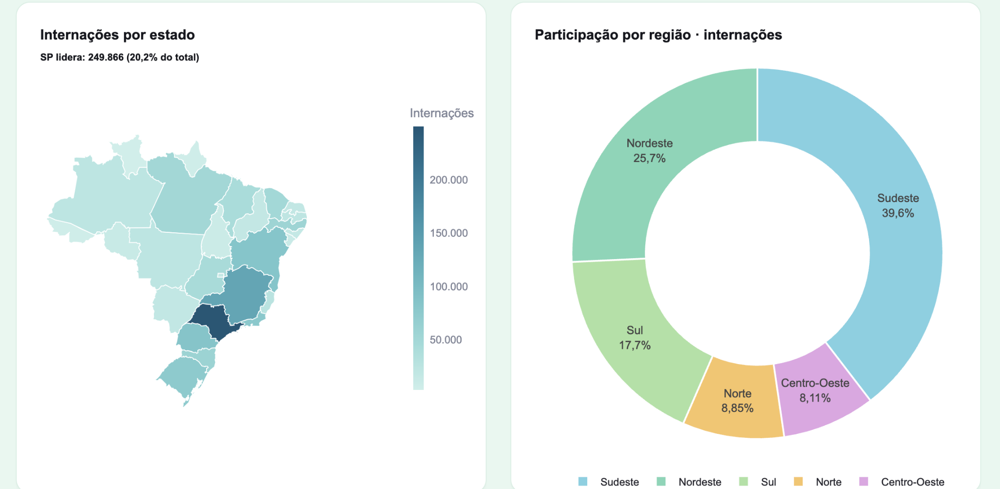
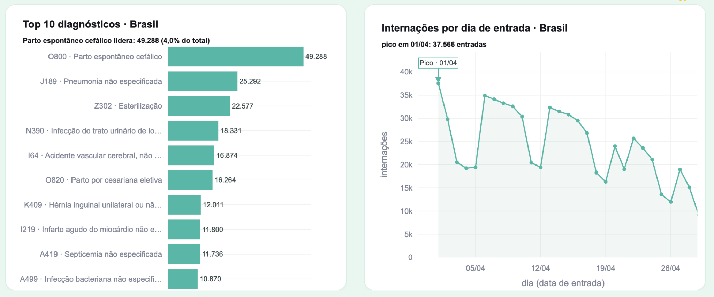

# Internações do SUS: pipeline de dados e painel por estado

[](https://github.com/Nayanearaujo/pipeline-saude-sus/actions/workflows/ci.yml)


Pipeline de engenharia de dados sobre os registros de internação do SIH/SUS,
com Python, DuckDB e SQL. O projeto transforma arquivos públicos do DATASUS
em dez marts, um painel em Streamlit e um relatório HTML.

**Competência de processamento: abril de 2026. Abrangência: Brasil.**
Uma AIH é uma autorização de internação hospitalar. Não representa uma pessoa única.
A distribuição geográfica considera a residência registrada, não o hospital.

## Acessos

- [Painel interativo em Streamlit](https://pipeline-saude-sus.streamlit.app/)
- [Relatório executivo em HTML](https://nayanearaujo.github.io/pipeline-saude-sus/relatorio.html)
- [Guia do projeto](https://nayanearaujo.github.io/pipeline-saude-sus/)
- [Definições dos indicadores](indicadores.md)
- [Validação e limites](VALIDACAO.md)
- [Planejamento do painel](design/rascunho.png)

## Demonstração

As imagens são capturas do painel em Streamlit. O relatório executivo usa os mesmos marts.

**Distribuição nacional e participação das regiões**



**Diagnósticos mais frequentes e internações por dia de entrada**



## Resultados publicados

| Medida | Resultado |
|---|---:|
| Registros brutos de internação | 1.238.763 |
| AIHs após a transformação | 1.238.234 |
| AIHs duplicadas excluídas | 529 |
| Exclusões por ausência de valor | 0 |
| Valor total registrado | R$ 2.258.865.118,36 |
| Dicionário CID na execução local corrigida | 14.240 códigos únicos |
| Dicionário de municípios | 5.571 códigos únicos |
| Marts da camada Ouro | 10 |
| Linhas nos dez CSVs publicados | 16.400 |
| Regras de qualidade aprovadas na execução local | 37 |

A conferência local final confirmou o valor exato com centavos, as 37 regras,
os 156 testes e a igualdade de todos os campos dos dez marts com os CSVs publicados.
A correção de idade ignorada não alterou os resultados deste conjunto.

## Arquitetura

| Etapa | Responsabilidade | Implementação |
|---|---|---|
| Preparação | Converter os arquivos `.dbc` e obter os dicionários | `baixar_dados.py`, `gerar_dicionarios.py` |
| Bronze | Ler os três arquivos com todas as colunas como texto | `pipeline/ingestao.py` |
| Prata | Declarar tipos, decodificar campos e manter uma linha por AIH | `pipeline/transformacao.py` |
| Ouro | Construir dez marts com grão explícito e regras em SQL | `pipeline/marts.py`, `sql/marts/` |
| Qualidade | Verificar domínio, unicidade, reconciliação e descrições | `pipeline/qualidade.py` |
| Publicação | Exportar os marts, montar o painel e gerar o HTML | `exportar_painel.py`, `app.py`, `relatorio.py` |

O valor financeiro usa `DECIMAL(12,2)`. A deduplicação prioriza valor preenchido,
alta mais recente e valor numérico, com critérios de desempate estáveis.
A mesma prioridade é usada na contagem de exclusões e na reconciliação.

O código CID é ligado às categorias e subcategorias de uma fonte versionada.
A revisão completou 1.048 descrições nacionais e reduziu as internações sem nome
de 36.736 para 76, aproximadamente 0,0061% do total. Os sete códigos ausentes no
espelho foram completados com fontes oficiais complementares. O limite de qualidade é de 0,1% das internações,
com nomes obrigatórios nos 20 primeiros diagnósticos nacionais e de mortalidade.

## Execução

Requisitos: Python 3.11 ou superior e `uv`. Execute os comandos na raiz do projeto.

```bash
uv sync --frozen
uv run python baixar_dados.py
uv run python gerar_dicionarios.py
uv run python executar.py
uv run python exportar_painel.py
uv run python relatorio.py
uv run streamlit run app.py
```

O download cobre as 27 UFs por padrão. Uma UF ausente bloqueia a publicação do
Parquet. Amostras parciais exigem `PERMITIR_PARCIAL=1` e não representam o Brasil.
Os arquivos brutos e o banco não são versionados.

A publicação do Parquet é atômica. A ingestão e a construção dos marts usam
transações. Os testes verificam falhas de escrita e preservação da versão anterior.

## Testes e conferência final

```bash
uv run ruff check .
uv run pytest --cov
```

O CI exige cobertura mínima de 95%. A medição inclui download, dicionários,
orquestração, transformação, qualidade, exportação e relatório. Apenas as
interfaces `app.py` e `ui.py`, os próprios testes e o ambiente virtual ficam fora.
Os testes usam dados sintéticos e simulações de rede, sem consultar o banco real.

**Resultado desta revisão: 156 testes e cobertura de 97,06%.**

Para repetir a validação completa com os arquivos locais, consulte
[CONFERENCIA_LOCAL.md](CONFERENCIA_LOCAL.md). O procedimento usa uma pasta
isolada, preserva os originais e compara os dez marts por conteúdo, não apenas
por quantidade de linhas.

## Painel e relatório

O painel abre na visão Brasil. O seletor de UF altera os cartões e o detalhe de
diagnósticos, datas de entrada e perfil demográfico. As análises complementares
de mortalidade por CID e concentração municipal permanecem nacionais e são
identificadas como Brasil. O painel não calcula novos indicadores.

São cinco cartões executivos e nove figuras. Média e mediana são distintas.
O gráfico regional usa apenas medidas aditivas. O mapa interativo usa geometria
local, fundo branco e WebGL. O HTML usa um mapa SVG completo e centralizado,
sem câmera nem dependência de WebGL. A curva municipal também usa SVG e não
depende de WebGL. O relatório inclui a tabela expansível do perfil, com filtros
de sexo e faixa etária. A biblioteca dos demais gráficos exige JavaScript.

O [rascunho](design/rascunho.png) é um planejamento identificado, não uma captura
do painel em funcionamento. As capturas da seção Demonstração mostram o painel em funcionamento.

## Auditoria de descrições e datas

O pipeline gera três arquivos locais em `data/auditoria/`: `cid_sem_descricao.csv`,
`datas_para_investigar.csv` e `entradas_por_mes.csv`. Não incluem identificadores de AIH.
A auditoria também pode ser executada com `uv run python -m pipeline.auditoria`.

As datas são comparadas com a competência, a saída e a permanência registrada.
Entrada anterior à competência em mais de dez anos é um critério de triagem,
não uma regra clínica. Saída anterior à entrada, datas ausentes, entradas posteriores
à competência e divergências de permanência são sinalizadas, sem exclusão automática.
Datas impossíveis, como 30 de fevereiro, interrompem a transformação.

Os sete códigos antes sem descrição foram completados por correspondência exata
nas [fontes oficiais registradas](docs/cid-complementar.csv). Os nomes de 76 AIHs
foram identificados, sem alteração de valores, posições ou contagens. Ausências
futuras recebem “Descrição não localizada na fonte” e entram na auditoria local.

A conferência local do commit `4510595` foi aprovada em duas execuções no macOS.
Os dez marts coincidiram com os CSVs publicados, e a auditoria não encontrou CID
sem descrição. Foram gerados 6.336 grupos para investigação de datas e permanências.
Esses grupos não equivalem ao número de internações com erro. A causa das datas
antigas ainda não foi comprovada.

## Indicadores e limites

As dez perguntas planejadas estão em [indicadores.md](indicadores.md).
Nove são viáveis com a base pública e deram origem aos dez marts. A reinternação
por paciente ficou fora do escopo, pois não há identificador pessoal que sustente
esse acompanhamento na base usada.

- A série de abril contém 703.067 entradas. As outras 535.167 têm datas anteriores,
  conforme o histograma local. Toda a Bronze tem competência abril de 2026.
- O SQL usa a competência de processamento preservada na Prata. Cada execução exige
  uma única competência. Arquivos de meses diferentes devem ser processados separadamente.
- Há 14.538 entradas registradas antes de 2026, incluindo 617 em 1º de janeiro de 2008.
  Não foram classificadas como datas padrão ou internações prolongadas sem investigação.
- Idade ignorada é mantida como desconhecida. Dias e meses são convertidos para
  a faixa de menos de um ano. A conferência final confirmou que os perfis deste conjunto permaneceram iguais.
- `VAL_TOT` é o valor registrado na AIH, não o custo econômico integral da assistência.
- Mortalidade hospitalar usa internações como denominador. Não mede mortalidade
  populacional e não é ajustada por gravidade, população ou composição dos casos.
- O recorte cobre uma única competência. Não sustenta análises de sazonalidade.

## Onde a IA errou

Usei sugestões de código como ponto de partida e conferi os resultados antes de aceitá-las.

- O dicionário inicial não cobria todas as categorias. A contagem revelou 1.055
  diagnósticos sem nome, associados a 36.736 internações. A correção por código
  exato deixou sete códigos e 76 internações sem descrição, sem mudar os valores.
- O desempate por data podia escolher uma duplicata sem valor. Um teste com duas
  linhas da mesma AIH passou de nenhuma linha válida preservada para uma.
- A cobertura excluía três scripts auxiliares. Com o escopo ampliado, medi 86,88%.
  Acrescentei testes sem reduzir o mínimo de 95%.
- A descrição de `mode()` confundia data mais frequente com mês de maior volume.
  Conferi o histograma e substituí a heurística pela competência explícita, sem forçar a série a somar o consolidado.
- A unidade de idade ignorada era tratada como menos de um ano. Corrigi a
  transformação e acrescentei testes para preservar a informação desconhecida.

## Fontes e licença

- [Microdados SIH/SUS, DATASUS](https://datasus.saude.gov.br/transferencia-de-arquivos/)
- [Dicionário CID-10 usado, fonte versionada](https://github.com/cleytonferrari/CidDataSus/tree/b6eb7d0fe8be752307741d156d67eacf539a186c/CIDImport/Repositorio/Resources)
- [API oficial de municípios do IBGE](https://servicodados.ibge.gov.br/api/v1/localidades/municipios)
- [Origem e licença da geometria do mapa](assets/LEIA-ME-mapa.md)

O código usa a [licença MIT](LICENSE). Os dados públicos mantêm suas condições
de uso de origem. Microdados, banco, credenciais e configurações privadas não
fazem parte da entrega. Os hashes e os limites de proveniência estão no
[manifesto da extração](docs/proveniencia-extracao.json).

## Autora

**Nayane Araújo**, pós-graduanda em Engenharia de Dados.

[GitHub](https://github.com/Nayanearaujo) · [LinkedIn](https://www.linkedin.com/in/nayane-araujo-548063195/)
